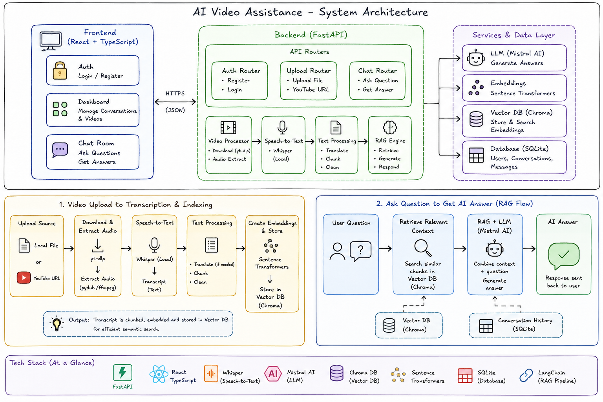

# AI Video Assistant

A full-stack application that provides intelligent video analysis, transcription, and chat capabilities using AI/ML technologies.

## ⚙️ Working



## 📋 Table of Contents

- [Project Structure](#project-structure)
- [Features](#features)
- [Tech Stack](#tech-stack)
- [Getting Started](#getting-started)
- [Backend Setup](#backend-setup)
- [Frontend Setup](#frontend-setup)
- [Configuration](#configuration)
- [Usage](#usage)
- [Project Structure](#project-structure)
- [Contributing](#contributing)

## ✨ Features

- **Video Upload & Processing**: Upload videos and automatically extract audio
- **Transcription**: Convert audio to text using transcription services
- **Vector Database**: Store and retrieve video information using embeddings
- **RAG Engine**: Retrieve relevant content using Retrieval-Augmented Generation
- **Chat Interface**: Interactive chat with AI about video content
- **Authentication**: Secure user authentication and authorization
- **Conversation Management**: Maintain conversation history with multiple videos

## 🛠️ Tech Stack

### Backend
- **Framework**: FastAPI (Python)
- **Database**: SQLite with Chroma for vector storage
- **Authentication**: JWT-based auth
- **API**: RESTful endpoints

### Frontend
- **Framework**: React with TypeScript
- **Router**: TanStack Router
- **Build Tool**: Vite
- **Styling**: Tailwind CSS
- **UI Components**: Custom + Shadcn/ui components

## 🚀 Getting Started

### Prerequisites
- Python 3.8+
- Node.js 16+
- npm or yarn

### Clone the Repository

```bash
git clone <repository-url>
cd "AI Video Assistance"
```

## 🔧 Backend Setup

### 1. Navigate to Backend Directory

```bash
cd backend
```

### 2. Create Virtual Environment

```bash
python -m venv venv
source venv/bin/activate  # On Windows: venv\Scripts\activate
```

### 3. Install Dependencies

```bash
pip install -r requirements.txt
```

### 4. Environment Configuration

Create a `.env` file in the backend directory with required variables:

```env
DATABASE_URL=sqlite:///./app.db
JWT_SECRET_KEY=your-secret-key
UPLOAD_DIR=./uploads
VECTOR_DB_DIR=./vector_db
```

### 5. Run Backend

```bash
python -m uvicorn app.main:app --reload
```

Backend will be available at `http://localhost:8000`

## 🎨 Frontend Setup

### 1. Navigate to Frontend Directory

```bash
cd frontend
```

### 2. Install Dependencies

```bash
npm install
# or
yarn install
```

### 3. Environment Configuration

Create a `.env` file in the frontend directory:

```env
VITE_API_URL=http://localhost:8000
VITE_API_TIMEOUT=30000
```

### 4. Run Development Server

```bash
npm run dev
# or
yarn dev
```

Frontend will be available at `http://localhost:5173`

## 📁 Project Structure

```
AI Video Assistance/
├── backend/                           # FastAPI backend server
│   ├── app/
│   │   ├── core/                     # Core AI/ML functionality
│   │   │   ├── extractor.py          # Extract metadata from videos
│   │   │   ├── rag_engine.py         # Retrieval-Augmented Generation engine
│   │   │   ├── summarizer.py         # Generate summaries using LLM
│   │   │   ├── transcriber.py        # Handle transcription requests
│   │   │   ├── vector_store.py       # Vector database operations
│   │   │   └── __init__.py
│   │   │
│   │   ├── routers/                  # API route handlers
│   │   │   ├── chat.py               # Chat message endpoints
│   │   │   ├── conversations.py      # Conversation management endpoints
│   │   │   ├── upload.py             # Video upload endpoints
│   │   │   ├── messages.py           # Message history endpoints
│   │   │   ├── LLM.py                # LLM interaction endpoints
│   │   │   └── __init__.py
│   │   │
│   │   ├── services/                 # Business logic layer
│   │   │   ├── audio.py              # Audio processing utilities
│   │   │   ├── chat_service.py       # Chat conversation logic
│   │   │   ├── chunking.py           # Text chunking for embeddings
│   │   │   ├── transcription_service.py  # Transcription orchestration
│   │   │   ├── upload_service.py     # Video upload handling
│   │   │   ├── youtube_service.py    # YouTube integration
│   │   │   └── __init__.py
│   │   │
│   │   ├── auth.py                   # JWT authentication & authorization
│   │   ├── database.py               # Database connection & session management
│   │   ├── models.py                 # SQLAlchemy ORM models
│   │   ├── schemas.py                # Pydantic request/response schemas
│   │   ├── enums.py                  # Enumeration types
│   │   ├── main.py                   # FastAPI application entry point
│   │   └── __init__.py
│   │
│   ├── tests/                        # Test suite
│   │   ├── test_auth.py              # Authentication tests
│   │   ├── test_chat_logic.py        # Chat functionality tests
│   │   ├── test_youtube_upload.py    # YouTube upload tests
│   │   ├── vector_retrive_test.py    # Vector retrieval tests
│   │   └── youtube_transcription.py  # Transcription tests
│   │
│   ├── uploads/                      # Temporary storage for uploaded videos
│   ├── vector_db/                    # Chroma vector database storage
│   │   ├── chroma.sqlite3            # Main vector DB
│   │   └── conversation_*/           # Conversation-specific embeddings
│   │
│   ├── requirements.txt              # Python dependencies
│   ├── README.md                     # Backend documentation
│   ├── test_auth.py                  # Quick authentication test
│   └── verify_auth.py                # Auth verification script
│
├── frontend/                         # React + TypeScript frontend
│   ├── src/
│   │   ├── components/               # Reusable React components
│   │   │   ├── ui/                  # Shadcn/ui component library
│   │   │   │   ├── button.tsx
│   │   │   │   ├── card.tsx
│   │   │   │   ├── dialog.tsx
│   │   │   │   ├── form.tsx
│   │   │   │   ├── input.tsx
│   │   │   │   └── ... (other UI components)
│   │   │   └── __init__.ts
│   │   │
│   │   ├── routes/                   # Page components (TanStack Router)
│   │   │   ├── __root.tsx            # Root layout
│   │   │   ├── index.tsx             # Home/landing page
│   │   │   ├── login.tsx             # Login page
│   │   │   ├── signup.tsx            # User registration page
│   │   │   ├── dashboard.tsx         # Main dashboard
│   │   │   ├── contact.tsx           # Contact page
│   │   │   └── README.md
│   │   │
│   │   ├── lib/                      # Utilities & helpers
│   │   │   ├── api.ts                # API client wrapper
│   │   │   ├── auth.ts               # Authentication helpers
│   │   │   ├── chat.ts               # Chat-related utilities
│   │   │   ├── conversations.ts      # Conversation management
│   │   │   ├── messages.ts           # Message handling
│   │   │   ├── utils.ts              # Common utilities
│   │   │   ├── error-capture.ts      # Error handling
│   │   │   ├── error-page.ts         # Error page utilities
│   │   │   └── lovable-error-reporting.ts
│   │   │
│   │   ├── hooks/                    # Custom React hooks
│   │   │   └── use-mobile.tsx        # Mobile responsiveness hook
│   │   │
│   │   ├── router.tsx                # Router configuration
│   │   ├── routeTree.gen.ts          # Auto-generated route tree
│   │   ├── server.ts                 # Server configuration
│   │   ├── start.ts                  # Application startup
│   │   └── styles.css                # Global styles
│   │
│   ├── public/                       # Static assets
│   │   └── (images, icons, etc.)
│   │
│   ├── components.json               # UI component configuration
│   ├── vite.config.ts                # Vite build configuration
│   ├── tsconfig.json                 # TypeScript configuration
│   ├── eslint.config.js              # Linting rules
│   ├── bunfig.toml                   # Bun configuration
│   ├── package.json                  # Dependencies & scripts
│   ├── AGENTS.md                     # Custom agent definitions
│   └── README.md                     # Frontend documentation
│
├── PROJECT_OVERVIEW.md               # High-level project overview
├── project_structure.md              # Detailed structure documentation
├── working.md                        # Development notes
└── README.md                         # This file
```

### Directory Details

**Backend (`/backend`)**
- **core/**: AI/ML processing pipeline components
  - Handles video transcription, embedding generation, RAG operations
  - Manages vector store for semantic search capabilities
  
- **routers/**: FastAPI route handlers
  - Maps HTTP requests to service layer functions
  - Handles request validation and response formatting
  
- **services/**: Business logic implementation
  - Orchestrates core functionality for various features
  - Integrates external services (transcription APIs, LLMs)
  
- **uploads/ & vector_db/**: Data storage
  - Stores uploaded videos and vector embeddings
  - Maintains conversation-specific vector indices

**Frontend (`/frontend`)**
- **components/**: Reusable UI building blocks
  - Shadcn/ui components provide consistent design system
  - Custom components wrap business logic
  
- **routes/**: Page-level components
  - Each file represents a distinct page/route
  - Uses TanStack Router for client-side routing
  
- **lib/**: API integration and utilities
  - Centralized API client for backend communication
  - Authentication token management
  - Business logic helpers (chat, conversations, messages)

## 🔌 API Endpoints

### Authentication
- `POST /auth/register` - Register new user
- `POST /auth/login` - Login user
- `POST /auth/logout` - Logout user

### Conversations
- `GET /conversations` - List all conversations
- `POST /conversations` - Create new conversation
- `GET /conversations/{id}` - Get conversation details
- `DELETE /conversations/{id}` - Delete conversation

### Chat
- `POST /chat/send` - Send message to chat
- `GET /chat/history/{conversation_id}` - Get chat history

### Upload
- `POST /upload` - Upload video file
- `GET /uploads/{file_id}` - Get upload status

### Messages
- `GET /messages/{conversation_id}` - Get messages in conversation
- `DELETE /messages/{id}` - Delete message

## 📝 Configuration

### Backend Configuration
Edit `backend/app/main.py` to configure:
- CORS settings
- Upload limits
- Database connections
- Vector store settings

### Frontend Configuration
Edit `frontend/vite.config.ts` and `frontend/src/server.ts` to configure:
- API endpoints
- Development server settings
- Build optimization

## 🧪 Testing

### Backend Tests

```bash
cd backend
pytest tests/
```

### Frontend Tests

```bash
cd frontend
npm run test
```

## 📦 Building for Production

### Backend

```bash
cd backend
# Run with production settings
python -m uvicorn app.main:app --host 0.0.0.0 --port 8000
```

### Frontend

```bash
cd frontend
npm run build
# Output in dist/ directory
```

## 🐛 Troubleshooting

### Backend Issues
- Ensure Python virtual environment is activated
- Check all dependencies are installed: `pip install -r requirements.txt`
- Verify database permissions in `vector_db` directory

### Frontend Issues
- Clear node_modules and reinstall: `rm -rf node_modules && npm install`
- Clear Vite cache: `rm -rf .vite`
- Check that backend is running on expected port

## 🤝 Contributing

1. Create a feature branch: `git checkout -b feature/your-feature`
2. Commit changes: `git commit -am 'Add your feature'`
3. Push to branch: `git push origin feature/your-feature`
4. Submit a pull request

## 📄 License

This project is licensed under the MIT License - see LICENSE file for details.

## 👥 Authors

Shriyansh Fasate

