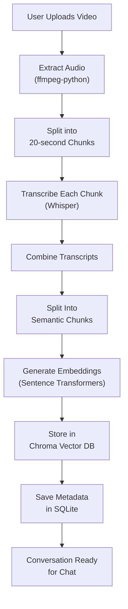
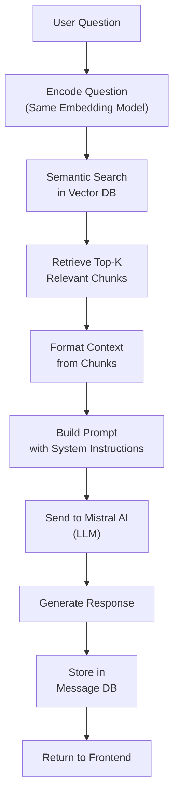
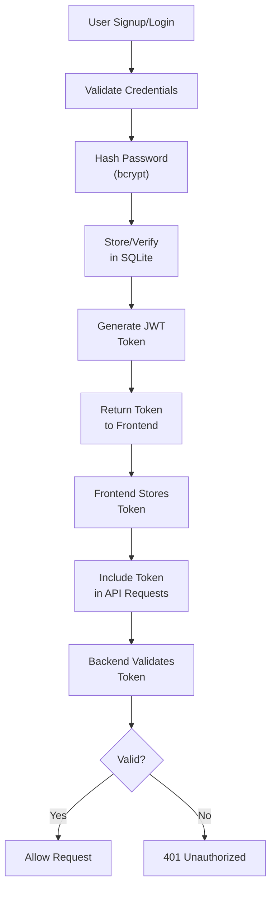

# 🎥 AI Video Assistance - Complete Working Documentation


## 📋 Table of Contents

1. [Project Overview](#project-overview)
2. [Tech Stack](#tech-stack)
3. [System Architecture](#system-architecture)
4. [Features](#features)
5. [Setup & Installation](#setup--installation)
6. [How It Works](#how-it-works)
7. [Database Schema](#database-schema)
8. [API Endpoints](#api-endpoints)
9. [Workflow Diagrams](#workflow-diagrams)
10. [Solutions & Key Implementations](#solutions--key-implementations)
11. [Folder Structure](#folder-structure)
12. [Deployment](#deployment)

---

## Project Overview

**AI Video Assistance** is a full-stack web application that enables users to:
- Upload or share YouTube videos
- Automatically transcribe video content using AI
- Ask intelligent questions about video content
- Get AI-powered responses using Retrieval-Augmented Generation (RAG)
- Maintain conversation history with multiple videos

### Core Problem Solved
Users can now interact with video content through natural language instead of watching entire videos. The system extracts, indexes, and retrieves relevant information from transcripts to answer questions accurately.

### Key Benefits
✅ **Time Saving**: No need to watch entire videos  
✅ **Information Retrieval**: Find specific information instantly  
✅ **Multi-Modal Support**: Handle local files and YouTube URLs  
✅ **Semantic Search**: Find contextually relevant content  
✅ **Scalable**: Vector database handles large transcripts efficiently  

---

## Tech Stack

### Backend
| Component | Technology | Version |
|-----------|-----------|---------|
| **Framework** | FastAPI | Latest |
| **Server** | Uvicorn | with standard extras |
| **Database** | SQLite | Latest |
| **ORM** | SQLAlchemy | Latest |
| **Authentication** | JWT + Passlib (bcrypt) | Latest |
| **API Documentation** | Swagger/OpenAPI | Built-in FastAPI |

### Video Processing
| Component | Technology | Purpose |
|-----------|-----------|---------|
| **YouTube Download** | yt-dlp | Extract audio from YouTube URLs |
| **Audio Conversion** | pydub + ffmpeg-python | Convert formats & extract audio |
| **Speech-to-Text** | OpenAI Whisper | Local speech recognition (English, Hindi, etc.) |
| **Audio Processing** | torch + torchaudio | PyTorch audio utilities |

### AI/ML Stack
| Component | Technology | Purpose |
|-----------|-----------|---------|
| **LLM Framework** | LangChain | Orchestration & RAG pipeline |
| **LLM Model** | Mistral AI | Small-latest model for responses |
| **Vector Database** | Chroma DB | Semantic search & embeddings |
| **Embeddings** | Sentence Transformers | HuggingFace models for semantic embeddings |
| **Text Splitting** | LangChain Recursive Splitter | Chunking transcripts efficiently |
| **Translation** | Deep Translator | Language conversion (Hindi → English) |

### Frontend
| Component | Technology | Version |
|-----------|-----------|---------|
| **Framework** | React | with TypeScript |
| **Router** | TanStack Router | v1.170+ |
| **Build Tool** | Vite | v4.x |
| **Styling** | Tailwind CSS | v3.x |
| **Form Management** | React Hook Form | v7.x |
| **UI Components** | Shadcn/ui + Radix UI | Custom configured |
| **HTTP Client** | Axios (custom API) | Latest |
| **State Management** | TanStack Query | v5.x |

### Development Tools
- **Linting**: ESLint
- **Formatting**: Prettier
- **Package Manager**: npm/yarn
- **API Testing**: Swagger UI (built-in)

---

## System Architecture

### High-Level Architecture

```
┌─────────────────────────────────────────────────────────────┐
│                    Frontend (React + TypeScript)            │
│                                                              │
│  ┌─────────────┐  ┌──────────────┐  ┌────────────────┐    │
│  │   Auth UI   │  │   Dashboard  │  │   Chat Room    │    │
│  │ (Login)     │  │ (Manage Conv)│  │  (Q&A)         │    │
│  └─────────────┘  └──────────────┘  └────────────────┘    │
│         │                 │                  │             │
│         └─────────────────┼──────────────────┘             │
│                           │                                │
│                    REST API (JSON)                          │
│                           │                                │
└───────────────────────────┼────────────────────────────────┘
                            ▼
┌─────────────────────────────────────────────────────────────┐
│                 Backend API (FastAPI + Python)              │
│                                                              │
│  ┌────────────────────────────────────────────────────────┐ │
│  │ API Routers Layer                                      │ │
│  │ ┌──────────────┐ ┌──────────────┐ ┌──────────────┐   │ │
│  │ │ Auth Router  │ │Upload Router │ │Chat Router   │   │ │
│  │ ├──────────────┤ ├──────────────┤ ├──────────────┤   │ │
│  │ │ POST /signup │ │ POST /upload │ │ POST /chat   │   │ │
│  │ │ POST /login  │ │ POST /youtube│ │ GET /history │   │ │
│  │ └──────────────┘ └──────────────┘ └──────────────┘   │ │
│  │                                                        │ │
│  │ ┌──────────────────┐  ┌──────────────────────────┐   │ │
│  │ │Conversations Rtr │  │Messages / LLM Routers    │   │ │
│  │ │ CRUD operations  │  │ Message history + Direct │   │ │
│  │ └──────────────────┘  │ LLM queries              │   │ │
│  │                        └──────────────────────────┘   │ │
│  └────────────────────────────────────────────────────────┘ │
│                           │                                 │
│  ┌────────────────────────────────────────────────────────┐ │
│  │ Core Services Layer                                    │ │
│  │                                                        │ │
│  │  ┌─────────────────────────────────────────────────┐  │ │
│  │  │ Video Processing Pipeline                       │  │ │
│  │  │                                                 │  │ │
│  │  │  [Video/YouTube URL]                           │  │ │
│  │  │         ↓                                       │  │ │
│  │  │  [Extract Audio] - audio.py                    │  │ │
│  │  │         ↓                                       │  │ │
│  │  │  [Split Audio] - 20sec chunks                  │  │ │
│  │  │         ↓                                       │  │ │
│  │  │  [Transcribe] - Whisper/Sarvam                 │  │ │
│  │  │         ↓                                       │  │ │
│  │  │  [Chunk Text] - semantic chunks                │  │ │
│  │  │         ↓                                       │  │ │
│  │  │  [Create Embeddings] - Sentence Transformers  │  │ │
│  │  │         ↓                                       │  │ │
│  │  │  [Store in Vector DB] - Chroma                 │  │ │
│  │  │                                                 │  │ │
│  │  └─────────────────────────────────────────────────┘  │ │
│  │                                                        │ │
│  │  ┌─────────────────────────────────────────────────┐  │ │
│  │  │ Chat & RAG Pipeline (chat_service.py)          │  │ │
│  │  │                                                 │  │ │
│  │  │  [User Question]                               │  │ │
│  │  │         ↓                                       │  │ │
│  │  │  [Embed Question] - same model as training    │  │ │
│  │  │         ↓                                       │  │ │
│  │  │  [Semantic Search] - Vector DB retrieval      │  │ │
│  │  │         ↓                                       │  │ │
│  │  │  [RAG Context Building]                        │  │ │
│  │  │         ↓                                       │  │ │
│  │  │  [LLM Processing] - Mistral Small Latest       │  │ │
│  │  │         ↓                                       │  │ │
│  │  │  [Response] to user                            │  │ │
│  │  │                                                 │  │ │
│  │  └─────────────────────────────────────────────────┘  │ │
│  │                                                        │ │
│  │  Services:                                             │ │
│  │  - transcription_service.py → Audio to text           │ │
│  │  - chunking.py → Split into semantic chunks          │ │
│  │  - upload_service.py → File handling                 │ │
│  │  - youtube_service.py → URL processing               │ │
│  │  - chat_service.py → Q&A logic                       │ │
│  │  - audio.py → Audio extraction/splitting             │ │
│  │                                                        │ │
│  └────────────────────────────────────────────────────────┘ │
│                           │                                 │
│  ┌────────────────────────────────────────────────────────┐ │
│  │ Core Models Layer (rag_engine.py, vector_store.py)    │ │
│  │                                                        │ │
│  │  • Vector Store Management (Chroma)                  │ │
│  │  • LLM Interface (Mistral)                           │ │
│  │  • Retriever Creation                                │ │
│  │  • RAG Chain Assembly                                │ │
│  │                                                        │ │
│  └────────────────────────────────────────────────────────┘ │
│                           │                                 │
│  ┌────────────────────────────────────────────────────────┐ │
│  │ Data Layer                                             │ │
│  │                                                        │ │
│  │  ┌──────────────────────┐   ┌───────────────────┐   │ │
│  │  │ SQLite Database      │   │ Chroma Vector DB  │   │ │
│  │  │ (app.db)             │   │ (chroma.sqlite3)  │   │ │
│  │  │                      │   │                   │   │ │
│  │  │ • Users              │   │ • Embeddings      │   │ │
│  │  │ • Conversations      │   │ • Transcript text │   │ │
│  │  │ • Messages           │   │ • Metadata        │   │ │
│  │  │ • Chat History       │   │                   │   │ │
│  │  │                      │   │ Collections:      │   │ │
│  │  └──────────────────────┘   │ conv_XXX per conv │   │ │
│  │                              │                   │   │ │
│  │                              └───────────────────┘   │ │
│  │                                                        │ │
│  │  Storage Locations:                                    │ │
│  │  • /uploads - uploaded video files                     │ │
│  │  • /vector_db - all vector databases                   │ │
│  │                                                        │ │
│  └────────────────────────────────────────────────────────┘ │
│                                                              │
└──────────────────────────────────────────────────────────────┘
```

---

## Features

### 1️⃣ Authentication & User Management
**Features:**
- User registration (signup with email & password)
- Secure login with JWT tokens
- Password hashing with bcrypt
- Protected endpoints with role-based access
- User profile endpoints

**Files Involved:**
- `backend/app/auth.py` - JWT & password logic
- `backend/app/routers/` - Auth endpoints
- `backend/app/models.py` - User model

**Security:**
- Passwords hashed with passlib + bcrypt
- JWT tokens for stateless authentication
- CORS configured for frontend

---

### 2️⃣ Video Upload & Processing

**Supported Formats:**
- Local files: MP4, AVI, MOV, MKV, FLV, etc.
- YouTube URLs: Direct URL support via yt-dlp
- Audio files: WAV, MP3, etc.

**Processing Pipeline:**
```
Video Input → Audio Extraction → Audio Chunking → Transcription
    ↓                ↓                ↓              ↓
(file/URL)      (ffmpeg)          (20s chunks)   (Whisper)
                                                    ↓
                                              Text Output
```

**Services:**
- `youtube_service.py` - Download from YouTube URLs
- `audio.py` - Extract and split audio files
- `upload_service.py` - File upload handling
- `transcription_service.py` - Orchestrate transcription

**Key Features:**
- Automatic audio extraction
- Smart chunking (20-second segments)
- Multi-language support (English, Hindi via translation)
- Handles multiple audio formats via ffmpeg

---

### 3️⃣ Transcription Engine

**Technology:** OpenAI Whisper (Local)

**Features:**
- Converts audio to text locally (no external API)
- Fast processing with PyTorch acceleration
- Supports multiple languages
- Automatic language detection

**Flow:**
```
Audio Chunks (20s each) 
    ↓
[Whisper Model]
    ↓
Individual Transcripts
    ↓
Combined Full Transcript
```

**Implementation:** `backend/app/core/transcriber.py`

---

### 4️⃣ Conversation Management

**Features:**
- Create multiple conversations per user
- Organize videos/conversations
- Edit conversation titles
- Delete conversations (with cascade delete)
- Track created/updated timestamps
- Store transcript paths and vector DB locations

**Database Model:**
```
Conversation:
├── id (UUID)
├── user_id (Foreign Key)
├── title (editable)
├── transcript (stored as text)
├── vector_db_path (points to Chroma DB)
├── created_at
└── updated_at
```

**Endpoints:**
- `GET /conversations` - List all user conversations
- `POST /conversations` - Create new conversation
- `GET /conversations/{id}` - Get conversation details
- `PUT /conversations/{id}` - Update title
- `DELETE /conversations/{id}` - Delete conversation

---

### 5️⃣ Vector Database & Semantic Search

**Technology:** Chroma DB

**How It Works:**

```
Transcript Text
    ↓
[Chunking Service] - Split into overlapping chunks
    ↓
Chunks: [chunk1, chunk2, chunk3, ...]
    ↓
[Sentence Transformer] - Convert to embeddings
    ↓
Embeddings: [vec1, vec2, vec3, ...]
    ↓
[Chroma DB] - Store in vector database
    ↓
[Semantic Search] - Find similar chunks
```

**Key Features:**
- Automatic chunking of large transcripts
- Sentence-based embeddings with semantic meaning
- Fast similarity search
- One vector store per conversation
- Metadata tracking (chunk source, position)

**Storage Structure:**
```
vector_db/
├── chroma.sqlite3 (main database)
├── conversation_15/
│   ├── chroma.sqlite3
│   └── 6a03c3da-7dbf-4098-a7d2-eb03c2443b4a/
├── conversation_16/
├── conversation_21/
└── ...
```

**Implementation:** 
- `backend/app/core/vector_store.py` - Chroma management
- `backend/app/services/chunking.py` - Text chunking logic

---

### 6️⃣ RAG (Retrieval-Augmented Generation) Engine

**How RAG Works:**

```
User Question: "What was discussed about feature X?"
    ↓
1. Question Embedding → Convert to vector
    ↓
2. Semantic Search → Find top-k similar transcript chunks
    ↓
3. Context Assembly → Prepare relevant excerpts
    ↓
4. Prompt Construction → Build LLM prompt with context
    ↓
5. LLM Processing → Mistral AI generates response
    ↓
6. Response → Answer with source from transcript
```

**System Prompt:**
```
"You are Loomly AI. You answer ONLY from the transcript.
Use the retrieved context below. If the answer exists, answer it.
If the answer is only partially present, answer using the available information.
Only say 'I could not find this information...' when nothing relevant is found."
```

**LLM Configuration:**
- Model: Mistral Small Latest
- Temperature: 0.3 (focused, consistent responses)
- API: Mistral AI official client

**Implementation:** `backend/app/core/rag_engine.py`

---

### 7️⃣ Chat Interface

**Features:**
- Real-time question answering
- Message history with roles (user/assistant)
- Context-aware responses
- Error handling and fallbacks
- Conversation-specific chats

**Database Model:**
```
Message:
├── id (UUID)
├── conversation_id (Foreign Key)
├── role (user/assistant)
├── content (message text)
├── created_at
└── updated_at
```

**Endpoints:**
- `GET /messages/{conversation_id}` - Get conversation history
- `POST /chat` - Submit question and get answer
- `GET /chat/history/{conversation_id}` - Full message history

**Features:**
- Auto-saves messages
- Maintains conversation context
- Handles streaming responses
- Error recovery

---

## Setup & Installation

### Prerequisites
- **Python 3.10+** (for backend)
- **Node.js 16+** (for frontend)
- **FFmpeg** (for audio processing)
- **Git**

### Environment Setup

#### 1. Clone Repository
```bash
git clone <your-repo-url>
cd "AI Video Assistance"
```

#### 2. Backend Setup

**Create Virtual Environment:**
```bash
cd backend
python -m venv venv

# On Windows
venv\Scripts\activate

# On macOS/Linux
source venv/bin/activate
```

**Install Dependencies:**
```bash
pip install -r requirements.txt
```

**Install FFmpeg:**
```bash
# Windows (using chocolatey)
choco install ffmpeg

# macOS (using homebrew)
brew install ffmpeg

# Linux (Ubuntu/Debian)
sudo apt-get install ffmpeg
```

**Environment Variables:**
Create `.env` file in `backend/` directory:
```env
# Database
DATABASE_URL=sqlite:///./app.db

# JWT Authentication
JWT_SECRET_KEY=your-super-secret-key-here-change-in-production

# File Storage
UPLOAD_DIR=./uploads
VECTOR_DB_DIR=./vector_db

# LLM Configuration
MISTRAL_API_KEY=your-mistral-api-key-here

# Optional: Transcription Service
SARVAM_API_KEY=your-sarvam-api-key-if-using-sarvam
```

**Run Backend:**
```bash
# From backend directory with venv activated
uvicorn app.main:app --reload --port 8000
```

Backend will be available at: `http://localhost:8000`
API docs: `http://localhost:8000/docs`

---

#### 3. Frontend Setup

**Install Dependencies:**
```bash
cd frontend
npm install
# or
yarn install
```

**Environment Variables:**
Create `.env` file in `frontend/` directory:
```env
VITE_API_URL=http://localhost:8000
```

**Run Development Server:**
```bash
npm run dev
# or
yarn dev
```

Frontend will be available at: `http://localhost:5173`

**Build for Production:**
```bash
npm run build
# or
yarn build
```

---

### Verification Steps

1. **Backend Health Check:**
```bash
curl http://localhost:8000/docs
```
Should return Swagger UI documentation.

2. **Frontend Health Check:**
Open `http://localhost:5173` in browser
Should load login page.

3. **Test Auth Flow:**
```bash
# Signup
curl -X POST http://localhost:8000/signup \
  -H "Content-Type: application/json" \
  -d '{
    "email": "test@example.com",
    "password": "testpass123",
    "full_name": "Test User"
  }'

# Login
curl -X POST http://localhost:8000/login \
  -H "Content-Type: application/json" \
  -d '{
    "email": "test@example.com",
    "password": "testpass123"
  }'
```

---

## How It Works

### Complete User Journey

```
1. USER REGISTRATION & LOGIN
   ├─ User opens app → /login page
   ├─ Clicks "Sign Up"
   ├─ Submits: email, password, full_name
   ├─ Backend: Hash password + Create user in SQLite
   ├─ Generate JWT token
   └─ Redirect to dashboard

2. DASHBOARD
   ├─ Show all user's conversations
   ├─ Display video titles + creation date
   ├─ Options: New conversation, Edit, Delete
   └─ Click conversation → Open chat room

3. CREATE NEW CONVERSATION
   ├─ Select video source: File OR YouTube URL
   ├─ Upload/Enter YouTube URL
   ├─ Backend processing starts...
   │
   ├─ Step 1: Extract Audio
   │  └─ ffmpeg extracts audio from video
   │
   ├─ Step 2: Split Audio
   │  └─ Split into 20-second chunks
   │
   ├─ Step 3: Transcribe
   │  └─ Each chunk through Whisper model
   │  └─ Combine into full transcript
   │
   ├─ Step 4: Create Embeddings
   │  └─ Chunk transcript into semantic pieces
   │  └─ Convert each chunk to vector embedding
   │  └─ Store in Chroma vector database
   │
   └─ Store conversation metadata in SQLite

4. CHAT INTERFACE
   ├─ Display conversation title + transcript preview
   ├─ Show message history
   └─ Input box for questions

5. ASK A QUESTION
   ├─ User types question: "What was mentioned about X?"
   ├─ Submit question
   │
   ├─ Backend Processing:
   │  ├─ Convert question to embedding (same model as training)
   │  ├─ Search vector DB for top-5 similar chunks
   │  ├─ Retrieve chunk content from vector DB
   │  ├─ Build context string from retrieved chunks
   │  ├─ Construct prompt: system + context + question
   │  ├─ Send to Mistral AI
   │  └─ Get response
   │
   ├─ Store user question in database
   ├─ Store AI response in database
   └─ Display response to user with source info

6. CONVERSATION MANAGEMENT
   ├─ View all messages in conversation
   ├─ Edit conversation title
   ├─ Delete conversation (cascade delete all messages)
   └─ Download chat history (optional feature)
```

---

### Data Flow Diagram

```
┌─────────────────────────────────────────────────────────────┐
│                        User Browser                          │
│                   (React Frontend)                           │
└────────────────────────┬────────────────────────────────────┘
                         │
                    HTTP/REST/JSON
                         │
         ┌───────────────┴───────────────┐
         │                               │
         ▼                               ▼
    ┌─────────────────┐         ┌──────────────────┐
    │  Auth Endpoints │         │  Chat Endpoints  │
    │ (Signup/Login)  │         │  (Questions)     │
    └────────┬────────┘         └────────┬─────────┘
             │                           │
             ▼                           ▼
    ┌──────────────────────────────────────────┐
    │     FastAPI Application                   │
    │  (Request validation + routing)           │
    └────────────────┬─────────────────────────┘
                     │
        ┌────────────┼────────────┬────────────┐
        │            │            │            │
        ▼            ▼            ▼            ▼
    ┌────────┐  ┌────────┐  ┌────────┐  ┌─────────────┐
    │ Auth   │  │Upload  │  │Chat    │  │Conversation│
    │Service │  │Service │  │Service │  │Service      │
    └────────┘  └────────┘  └────────┘  └─────────────┘
        │            │            │            │
        ├────────────┼────────────┼────────────┤
        │                         │            │
        ▼                         ▼            ▼
    ┌──────────────────┐  ┌──────────────────┐
    │ SQLite Database  │  │ Chroma Vector DB │
    │                  │  │                  │
    │ • Users          │  │ • Embeddings     │
    │ • Conversations  │  │ • Metadata       │
    │ • Messages       │  │                  │
    └──────────────────┘  └──────────────────┘
        ▲                         ▲
        │                         │
    ┌───┴─────────────────────────┴────────────┐
    │                                           │
    │  Video Processing Services:              │
    │  - Transcription (Whisper)               │
    │  - Audio Extraction                      │
    │  - Chunking                              │
    │  - Embedding Generation                  │
    │                                           │
    └─────────────────────────────────────────┘
             │
             ▼
        ┌──────────────┐
        │ External APIs│
        │ • Mistral AI │
        │ • HuggingFace│
        └──────────────┘
```

---

## Database Schema

### SQLite Database (app.db)

#### Table: `user`
```sql
CREATE TABLE user (
    id          UUID PRIMARY KEY,
    email       VARCHAR(255) UNIQUE NOT NULL,
    full_name   VARCHAR(255) NOT NULL,
    hashed_password VARCHAR(255) NOT NULL,
    role        VARCHAR(50) DEFAULT 'user',
    is_active   BOOLEAN DEFAULT TRUE,
    created_at  TIMESTAMP DEFAULT CURRENT_TIMESTAMP,
    updated_at  TIMESTAMP DEFAULT CURRENT_TIMESTAMP
);
```

#### Table: `conversation`
```sql
CREATE TABLE conversation (
    id              UUID PRIMARY KEY,
    user_id         UUID NOT NULL,
    title           VARCHAR(255) NOT NULL,
    transcript      TEXT,  -- Full transcript text
    vector_db_path  VARCHAR(500),  -- Path to vector database
    created_at      TIMESTAMP DEFAULT CURRENT_TIMESTAMP,
    updated_at      TIMESTAMP DEFAULT CURRENT_TIMESTAMP,
    FOREIGN KEY (user_id) REFERENCES user(id) ON DELETE CASCADE
);
```

#### Table: `message`
```sql
CREATE TABLE message (
    id              UUID PRIMARY KEY,
    conversation_id UUID NOT NULL,
    role            VARCHAR(50) NOT NULL,  -- 'user' or 'assistant'
    content         TEXT NOT NULL,
    created_at      TIMESTAMP DEFAULT CURRENT_TIMESTAMP,
    updated_at      TIMESTAMP DEFAULT CURRENT_TIMESTAMP,
    FOREIGN KEY (conversation_id) REFERENCES conversation(id) ON DELETE CASCADE
);
```

### Chroma Vector Database

**Structure:**
```
vector_db/
├── chroma.sqlite3 (main metadata)
└── conversation_XXX/
    ├── chroma.sqlite3
    └── collection_id/
        └── [Vector indices & metadata]
```

**Data Stored Per Conversation:**
- Document embeddings (768-dimensional vectors)
- Transcript chunks with metadata:
  - `chunk_id`: Unique identifier
  - `text`: Actual transcript text
  - `start_time`: Position in transcript
  - `end_time`: Position in transcript
  - `conversation_id`: Link to conversation

---

## API Endpoints

### Authentication

#### POST `/signup`
**Description:** Register a new user
```json
{
  "email": "user@example.com",
  "password": "securepassword",
  "full_name": "John Doe"
}
```
**Response:**
```json
{
  "access_token": "eyJhbGc...",
  "user": {
    "id": "uuid",
    "email": "user@example.com",
    "full_name": "John Doe",
    "role": "user"
  }
}
```

#### POST `/login`
**Description:** Login user
```json
{
  "email": "user@example.com",
  "password": "securepassword"
}
```
**Response:** Same as signup

#### GET `/me`
**Description:** Get current user profile
**Headers:** `Authorization: Bearer {token}`
**Response:**
```json
{
  "id": "uuid",
  "email": "user@example.com",
  "full_name": "John Doe"
}
```

#### GET `/dashboard`
**Description:** Get dashboard data
**Headers:** `Authorization: Bearer {token}`
**Response:**
```json
{
  "message": "Welcome to your dashboard",
  "user": { ... }
}
```

---

### Conversations

#### GET `/conversations`
**Description:** List all user conversations
**Headers:** `Authorization: Bearer {token}`
**Response:**
```json
[
  {
    "id": "uuid",
    "title": "Lecture on AI",
    "transcript": "...",
    "vector_db_path": "./vector_db/conversation_15",
    "created_at": "2024-01-15T10:30:00",
    "updated_at": "2024-01-15T10:30:00"
  }
]
```

#### POST `/conversations`
**Description:** Create new conversation
**Headers:** `Authorization: Bearer {token}`
```json
{
  "title": "New Conversation",
  "transcript": "transcript text here"
}
```
**Response:** Created conversation object

#### GET `/conversations/{conversation_id}`
**Description:** Get conversation details
**Headers:** `Authorization: Bearer {token}`
**Response:** Conversation object with full details

#### PUT `/conversations/{conversation_id}`
**Description:** Update conversation
**Headers:** `Authorization: Bearer {token}`
```json
{
  "title": "Updated Title"
}
```

#### DELETE `/conversations/{conversation_id}`
**Description:** Delete conversation
**Headers:** `Authorization: Bearer {token}`
**Response:** Success message

---

### Messages & Chat

#### GET `/messages/{conversation_id}`
**Description:** Get all messages in conversation
**Headers:** `Authorization: Bearer {token}`
**Response:**
```json
[
  {
    "id": "uuid",
    "conversation_id": "uuid",
    "role": "user",
    "content": "What is AI?",
    "created_at": "2024-01-15T10:35:00"
  },
  {
    "id": "uuid",
    "conversation_id": "uuid",
    "role": "assistant",
    "content": "Based on the transcript...",
    "created_at": "2024-01-15T10:35:05"
  }
]
```

#### POST `/chat`
**Description:** Ask a question about video
**Headers:** `Authorization: Bearer {token}`
```json
{
  "conversation_id": "uuid",
  "message": "What was discussed about feature X?"
}
```
**Response:**
```json
{
  "id": "uuid",
  "conversation_id": "uuid",
  "role": "assistant",
  "content": "According to the transcript, feature X was discussed...",
  "created_at": "2024-01-15T10:35:05"
}
```

---

### Upload & Processing

#### POST `/upload`
**Description:** Upload video file
**Headers:** `Authorization: Bearer {token}`, `Content-Type: multipart/form-data`
**Body:**
```
file: <video file>
title: "Conversation Title"
```
**Response:**
```json
{
  "status": "processing",
  "conversation_id": "uuid",
  "message": "Video processing started..."
}
```

#### POST `/youtube`
**Description:** Process YouTube URL
**Headers:** `Authorization: Bearer {token}`
```json
{
  "url": "https://youtube.com/watch?v=...",
  "title": "YouTube Video"
}
```
**Response:** Same as upload

---

### LLM Endpoints

#### POST `/llm/query`
**Description:** Direct LLM query (without RAG)
**Headers:** `Authorization: Bearer {token}`
```json
{
  "message": "Direct question"
}
```
**Response:**
```json
{
  "response": "LLM response..."
}
```

---

## Workflow Diagrams

### Video Processing Workflow



### Chat & RAG Workflow



### Authentication Workflow



---

## Solutions & Key Implementations

### 1. Efficient Transcription Pipeline

**Problem:** Long videos (1+ hours) take too long to transcribe with single-pass approach

**Solution:**
- Split audio into 20-second chunks
- Process chunks in parallel when possible
- Combine outputs into continuous transcript
- Store full transcript for reference

**Implementation:** `backend/app/services/transcription_service.py`

```python
def transcribe_file(file_path: str, language: str = "english"):
    # Extract audio
    wav_path = extract_audio(file_path)
    
    # Split into chunks
    chunks = split_audio(wav_path, chunk_seconds=20)
    
    # Transcribe all chunks
    transcript = transcribe_all(chunks, language=language)
    
    return transcript
```

---

### 2. Vector Database Organization

**Problem:** Multiple conversations need separate vector spaces

**Solution:**
- Create one Chroma collection per conversation
- Store vector database at: `vector_db/conversation_{id}/`
- Use conversation_id as metadata in embeddings
- Retrieve only conversation-specific results

**Implementation:** `backend/app/core/vector_store.py`

```python
def build_vector_store(transcript: str, save_path: str):
    # Create Chroma database for this conversation
    vectorstore = Chroma.from_documents(
        documents=docs,
        embedding=HuggingFaceEmbeddings(),
        persist_directory=save_path
    )
    return vectorstore

def get_retriever(vector_db_path: str):
    vectorstore = Chroma(
        persist_directory=vector_db_path,
        embedding_function=HuggingFaceEmbeddings()
    )
    return vectorstore.as_retriever(search_kwargs={"k": 5})
```

---

### 3. RAG Context Building

**Problem:** LLM can hallucinate if not grounded in transcript

**Solution:**
- Retrieve only relevant chunks from transcript
- Use system prompt to enforce transcript-only mode
- Include context in every prompt
- Fall back gracefully when no relevant chunks found

**Implementation:** `backend/app/core/rag_engine.py`

```python
PROMPT = ChatPromptTemplate.from_messages([
    ("system", """You are Loomly AI.
    You answer ONLY from the transcript.
    Use the retrieved context below.
    
    Context:
    {context}
    """),
    ("human", "{question}")
])

def create_rag_chain():
    llm = get_llm()
    retriever = get_retriever(vector_db_path)
    
    rag_chain = (
        {"context": retriever | format_docs, "question": RunnablePassthrough()}
        | PROMPT
        | llm
        | StrOutputParser()
    )
    
    return rag_chain
```

---

### 4. Multi-Format Video Support

**Problem:** Videos come in different formats, codecs, and from different sources

**Solution:**
- FFmpeg handles format conversion automatically
- yt-dlp downloads YouTube videos
- Support both file upload and URL
- Graceful error handling for unsupported formats

**Implementation:** `backend/app/services/youtube_service.py` & `audio.py`

```python
def extract_audio(file_path: str) -> str:
    """Convert any video format to WAV"""
    output_path = f"{file_path}.wav"
    
    stream = ffmpeg.input(file_path)
    stream = ffmpeg.output(stream, output_path, acodec='pcm_s16le', ac=1, ar=16000)
    ffmpeg.run(stream, overwrite_output=True)
    
    return output_path

def download_youtube_video(url: str) -> str:
    """Download from YouTube and extract audio"""
    ydl_opts = {
        'format': 'bestaudio/best',
        'postprocessors': [{
            'key': 'FFmpegExtractAudio',
            'preferredcodec': 'wav',
            'preferredquality': '192',
        }],
        'outtmpl': 'downloads/%(title)s',
    }
    
    with yt_dlp.YoutubeDL(ydl_opts) as ydl:
        info = ydl.extract_info(url, download=True)
        return f"{info['_filename']}.wav"
```

---

### 5. Semantic Chunking

**Problem:** Naive splitting breaks sentences and loses context

**Solution:**
- Use LangChain's RecursiveCharacterTextSplitter
- Chunk size: 512 tokens
- Overlap: 50 tokens
- Preserves sentences and paragraphs

**Implementation:** `backend/app/services/chunking.py`

```python
from langchain.text_splitter import RecursiveCharacterTextSplitter

def chunk_transcript(transcript: str):
    splitter = RecursiveCharacterTextSplitter(
        chunk_size=512,
        chunk_overlap=50,
        separators=["\n\n", "\n", ".", " ", ""]
    )
    
    chunks = splitter.split_text(transcript)
    return chunks
```

---

### 6. Secure Authentication

**Problem:** Need to securely store passwords and manage sessions

**Solution:**
- Passwords hashed with bcrypt (not plain)
- JWT tokens for stateless auth
- Tokens include user email and role
- Backend validates token on every request

**Implementation:** `backend/app/auth.py`

```python
def get_password_hash(password):
    return pwd_context.hash(password)

def verify_password(plain_password, hashed_password):
    return pwd_context.verify(plain_password, hashed_password)

def create_access_token(data: dict):
    to_encode = data.copy()
    encoded_jwt = jwt.encode(to_encode, SECRET_KEY, algorithm=ALGORITHM)
    return encoded_jwt

@router.get("/me")
def get_current_user(token: str = Depends(oauth2_scheme)):
    payload = jwt.decode(token, SECRET_KEY, algorithms=[ALGORITHM])
    email: str = payload.get("sub")
    user = db.query(User).filter(User.email == email).first()
    return user
```

---

### 7. Error Handling & Recovery

**Features:**
- Try-catch blocks in all services
- Cleanup of temporary files
- Graceful error messages
- Logging for debugging

**Example:** `backend/app/services/transcription_service.py`

```python
def transcribe_file(file_path: str, language: str = "english"):
    wav_path = None
    chunks = []
    
    try:
        wav_path = extract_audio(file_path)
        chunks = split_audio(wav_path, chunk_seconds=20)
        transcript = transcribe_all(chunks, language=language)
        return transcript
    
    except Exception as e:
        logger.error(f"Transcription failed: {e}")
        raise
    
    finally:
        # Always cleanup temporary files
        cleanup_files(chunks)
        if wav_path != file_path:
            cleanup_files([wav_path])
```

---

### 8. Frontend State Management

**Architecture:**
- TanStack Query for server state
- React Router for navigation
- Context API for auth state
- Local state for form handling

**Example API Call:**
```typescript
// frontend/src/lib/api.ts
export async function chatWithVideo(
  conversationId: string,
  message: string
) {
  const response = await axios.post(
    `${API_URL}/chat`,
    {
      conversation_id: conversationId,
      message
    },
    {
      headers: {
        Authorization: `Bearer ${getToken()}`
      }
    }
  );
  return response.data;
}
```

---

## Folder Structure

### Backend Structure
```
backend/
├── app/
│   ├── __init__.py
│   ├── main.py                 # FastAPI app setup, routes, auth endpoints
│   ├── auth.py                 # JWT, password hashing, token validation
│   ├── database.py             # SQLAlchemy setup, session management
│   ├── models.py               # SQLAlchemy models (User, Conversation, Message)
│   ├── schemas.py              # Pydantic schemas for validation
│   ├── enums.py                # Enum definitions
│   │
│   ├── core/                   # Core AI/ML services
│   │   ├── extractor.py        # Extract info from transcripts
│   │   ├── rag_engine.py       # RAG pipeline (retrieval + LLM)
│   │   ├── summarizer.py       # Generate summaries
│   │   ├── transcriber.py      # Whisper wrapper
│   │   └── vector_store.py     # Chroma DB management
│   │
│   ├── routers/                # API endpoint handlers
│   │   ├── chat.py            # Chat endpoints
│   │   ├── conversations.py   # Conversation CRUD
│   │   ├── LLM.py             # Direct LLM queries
│   │   ├── messages.py        # Message endpoints
│   │   └── upload.py          # File/YouTube upload
│   │
│   ├── services/               # Business logic services
│   │   ├── audio.py           # Audio extraction & splitting
│   │   ├── chat_service.py    # Chat logic
│   │   ├── chunking.py        # Text chunking
│   │   ├── transcription_service.py  # Orchestrate transcription
│   │   ├── upload_service.py  # Handle uploads
│   │   └── youtube_service.py # YouTube download
│   │
│   └── (Continuation)
│
├── tests/                      # Test files
│   ├── test_auth.py
│   ├── test_chat_logic.py
│   ├── test_youtube_upload.py
│   └── vector_retrive_test.py
│
├── uploads/                    # Temporary uploaded files
├── vector_db/                  # Chroma vector databases
│   ├── chroma.sqlite3
│   └── conversation_XXX/       # One per conversation
│
├── requirements.txt            # Python dependencies
├── README.md
└── app.db                      # SQLite database

### Frontend Structure
frontend/
├── src/
│   ├── components/
│   │   ├── ui/                # Shadcn/ui components
│   │   │   ├── button.tsx
│   │   │   ├── input.tsx
│   │   │   ├── card.tsx
│   │   │   ├── dialog.tsx
│   │   │   └── ... (20+ UI components)
│   │   │
│   │   └── (Custom components as needed)
│   │
│   ├── hooks/
│   │   └── use-mobile.tsx     # Mobile detection hook
│   │
│   ├── lib/
│   │   ├── api.ts             # API calls (axios wrapper)
│   │   ├── auth.ts            # Auth utilities
│   │   ├── chat.ts            # Chat functions
│   │   ├── conversations.ts   # Conversation functions
│   │   ├── messages.ts        # Message functions
│   │   ├── utils.ts           # Utility functions
│   │   └── error-*.ts         # Error handling
│   │
│   ├── routes/
│   │   ├── __root.tsx         # Root layout
│   │   ├── index.tsx          # Home/Dashboard
│   │   ├── login.tsx          # Login page
│   │   ├── signup.tsx         # Signup page
│   │   ├── dashboard.tsx      # Main dashboard
│   │   ├── contact.tsx        # Contact page
│   │   └── README.md
│   │
│   ├── router.tsx             # Route definitions
│   ├── routeTree.gen.ts       # Auto-generated route tree
│   ├── start.ts               # App entry
│   ├── server.ts              # Server setup
│   └── styles.css             # Global styles
│
├── public/                    # Static assets
├── package.json               # Frontend dependencies
├── tsconfig.json              # TypeScript config
├── vite.config.ts             # Vite config
├── eslint.config.js           # ESLint config
├── components.json            # Shadcn config
└── bunfig.toml               # Bun config
```

---

## Deployment

### Backend Deployment

#### Option 1: Docker (Recommended)

**Create Dockerfile:**
```dockerfile
FROM python:3.11-slim

WORKDIR /app

COPY requirements.txt .
RUN pip install --no-cache-dir -r requirements.txt

COPY . .

CMD ["uvicorn", "app.main:app", "--host", "0.0.0.0", "--port", "8000"]
```

**Create docker-compose.yml:**
```yaml
version: '3.8'

services:
  backend:
    build: ./backend
    ports:
      - "8000:8000"
    environment:
      DATABASE_URL: sqlite:///./app.db
      JWT_SECRET_KEY: ${JWT_SECRET_KEY}
      MISTRAL_API_KEY: ${MISTRAL_API_KEY}
    volumes:
      - ./backend/uploads:/app/uploads
      - ./backend/vector_db:/app/vector_db
    restart: unless-stopped

  frontend:
    build: ./frontend
    ports:
      - "5173:5173"
    environment:
      VITE_API_URL: http://localhost:8000
    depends_on:
      - backend
    restart: unless-stopped
```

**Deploy:**
```bash
docker-compose up -d
```

#### Option 2: Cloud Platforms

**Heroku:**
```bash
heroku login
heroku create ai-video-app
git push heroku main
```

**AWS Lambda + API Gateway:**
- Use Zappa for WSGI deployment
- Store files in S3
- Use RDS for database

**GCP Cloud Run:**
```bash
gcloud run deploy ai-video-app \
  --source . \
  --platform managed \
  --region us-central1 \
  --allow-unauthenticated
```

### Frontend Deployment

#### Option 1: Vercel (Recommended for Next.js/Vite)

```bash
npm install -g vercel
vercel login
vercel
```

#### Option 2: Netlify

```bash
npm install -g netlify-cli
netlify login
netlify deploy --prod --dir=frontend/dist
```

#### Option 3: GitHub Pages / AWS S3 + CloudFront

```bash
npm run build
# Upload frontend/dist to S3
# Configure CloudFront CDN
```

---

## Environment Variables Checklist

### Backend (.env)
- [ ] `DATABASE_URL` - SQLite path
- [ ] `JWT_SECRET_KEY` - Secret key for JWT
- [ ] `UPLOAD_DIR` - Path for uploads
- [ ] `VECTOR_DB_DIR` - Path for vector databases
- [ ] `MISTRAL_API_KEY` - Mistral API key
- [ ] `SARVAM_API_KEY` - (Optional) Sarvam transcription API

### Frontend (.env)
- [ ] `VITE_API_URL` - Backend API URL

---

## Testing

### Backend Tests
```bash
cd backend
pytest tests/

# Run specific test
pytest tests/test_auth.py

# Run with coverage
pytest --cov=app tests/
```

### Frontend Tests
```bash
cd frontend
npm test

# Watch mode
npm test -- --watch
```

---

## Troubleshooting

### Common Issues

**1. FFmpeg not found**
```
Solution: Install FFmpeg
Windows: choco install ffmpeg
Mac: brew install ffmpeg
Linux: sudo apt-get install ffmpeg
```

**2. CORS errors**
```
Solution: Check CORS origins in backend/app/main.py
Make sure frontend URL is in allowed_origins
```

**3. Vector DB not found**
```
Solution: Ensure VECTOR_DB_DIR path exists and is writable
Create directory: mkdir -p backend/vector_db
```

**4. Mistral API errors**
```
Solution: Check MISTRAL_API_KEY in .env
Verify API key is valid and has quota
```

**5. Database locked**
```
Solution: Close all connections to app.db
Restart the backend server
```

---

## Performance Optimization

### Backend
- Use connection pooling for database
- Cache embeddings in vector DB
- Implement request rate limiting
- Use async operations where possible

### Frontend
- Code splitting with Vite
- Image lazy loading
- Component memoization
- TanStack Query caching

---

## Security Best Practices

✅ **Implemented:**
- Password hashing with bcrypt
- JWT authentication
- CORS protection
- SQL parameterization (SQLAlchemy ORM)

📋 **Recommended for Production:**
- Use HTTPS/TLS
- Implement rate limiting
- Add request logging
- Use environment variables for secrets
- Implement audit logging
- Add input validation (already using Pydantic)
- Use security headers (HSTS, CSP, etc.)
- Regular security updates

---

## Monitoring & Logging

### Backend Logging
```python
import logging

logger = logging.getLogger(__name__)

# Log important events
logger.info(f"Conversation created: {conversation_id}")
logger.error(f"Transcription failed: {error}")
```

### Frontend Error Tracking
```typescript
// Use Sentry or similar for error tracking
import * as Sentry from "@sentry/react";

Sentry.init({
  dsn: "your-sentry-dsn",
  environment: process.env.NODE_ENV,
});
```

---

## Future Enhancements

- [ ] Real-time chat (WebSocket support)
- [ ] Video summary generation
- [ ] Multi-language support
- [ ] Export conversation as PDF
- [ ] Collaborative conversations
- [ ] Advanced search filters
- [ ] Citation tracking
- [ ] Batch processing for multiple videos
- [ ] Fine-tuning LLM for specific domains
- [ ] Mobile app (React Native)

---

## Support & Resources

- **API Docs:** `http://localhost:8000/docs` (Swagger UI)
- **Backend Logs:** Check console output
- **Frontend Logs:** Browser developer console
- **Database:** SQLite Browser recommended for inspection

---

**Last Updated:** 2024-01-16  
**Version:** 1.0.0  
**Status:** Development Ready
